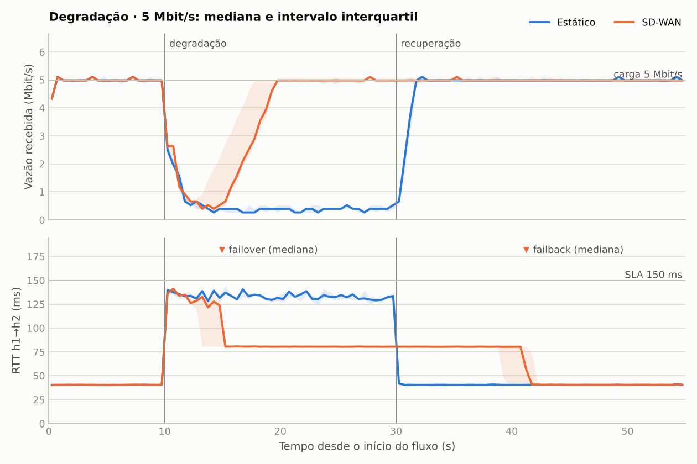
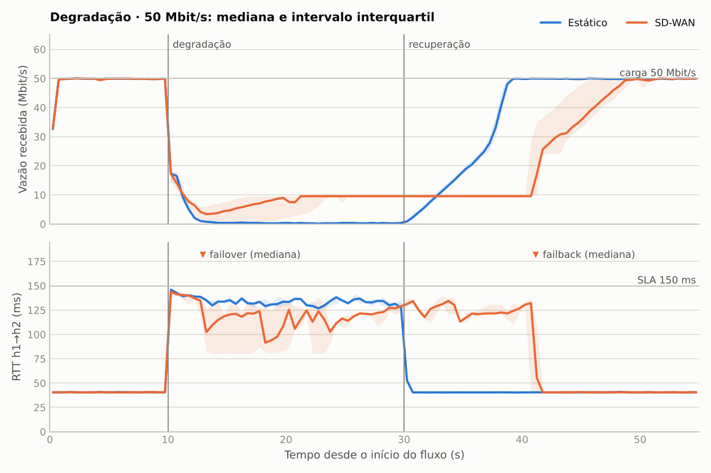
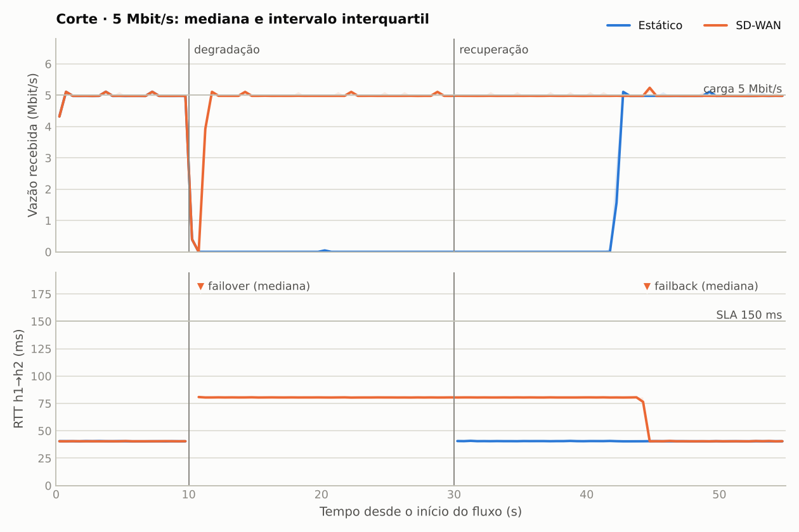
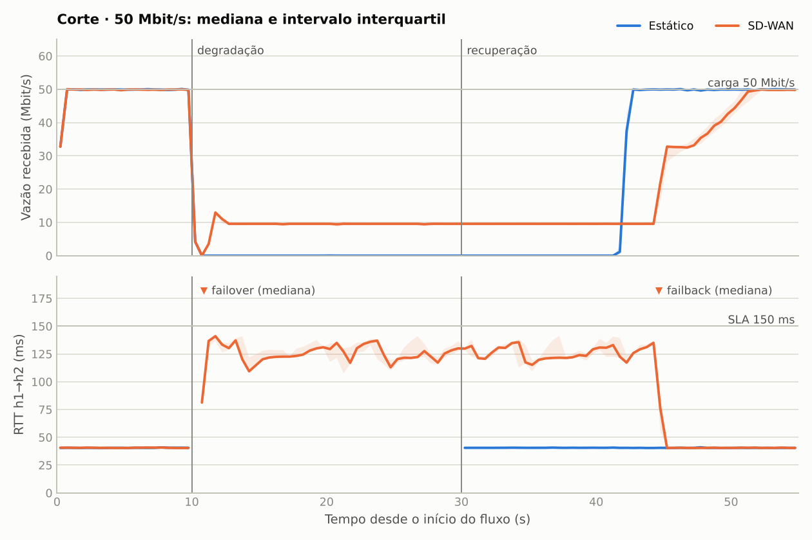
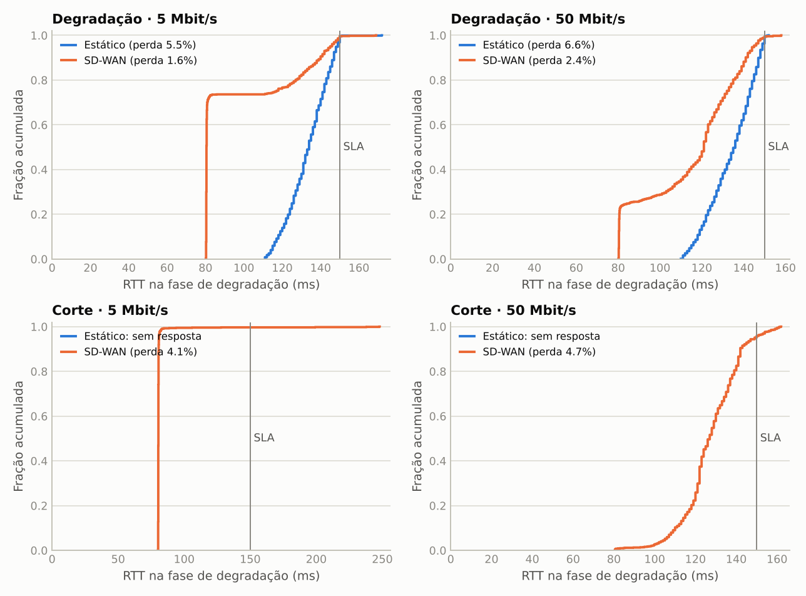
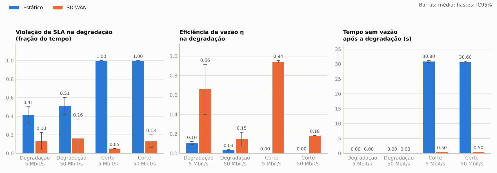
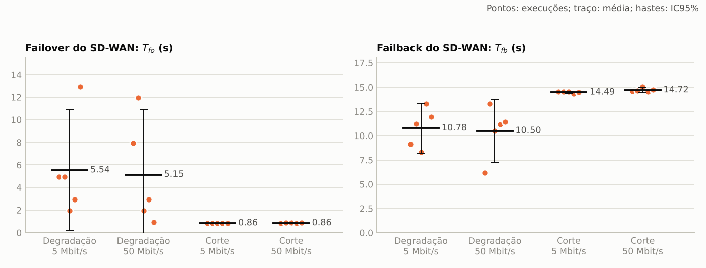

# Estático (tipo MPLS) vs SD-WAN em topologia diamante: resultados

## 1. Ambiente e backend

**Backend usado: emulação híbrida.** Namespaces de rede, roteamento, TCP, `iperf3` e `ping` são os do kernel Linux; a banda é limitada por `tc tbf`; atraso, jitter e perda são aplicados por um elemento em espaço de usuário (`topo/wire.c`), porque o kernel do ambiente não tem `tc netem`. Não é Mininet nem simulação discreta.

| Item | Valor |
|---|---|
| kernel | 6.18.44-fc-v114 |
| python | 3.13.16 |
| iproute2 | ip utility, iproute2-6.1.0, libbpf 1.3.0 |
| iperf3 | iperf 3.16 (cJSON 1.7.15) |
| ping | ping from iputils 20240117 |
| gcc | gcc (Ubuntu 13.3.0-6ubuntu2~24.04.1) 13.3.0 |
| cpuCount | 2 |
| controle de congestionamento TCP | cubic |

## 2. Validação da topologia

Tolerância: ±5%. Resultado geral: **dentro da tolerância**.

| Caminho | RTT medido (ms) | RTT nominal (ms) | Erro | Banda medida (Mbit/s) | Banda nominal (Mbit/s) | Erro | Vazão TCP (Mbit/s) |
|---|---|---|---|---|---|---|---|
| premium | 41.12 | 40 | +2.8% | 100.00 | 100 | -0.0% | 92.33 |
| backup | 81.23 | 80 | +1.5% | 10.00 | 10 | +0.0% | 9.07 |

## 3. Parâmetros

- Linha do tempo: degradação em $t=10$ s, recuperação em $t=30$ s, fim em $t=55$ s.
- Repetições por configuração: 5 a 5 (total de 40 execuções válidas).
- SLA: RTT < 150 ms e perda < 1%, avaliado em janelas de 1 s do `ping` h1→h2.
- Agente: sondagem a cada 1 s com 5 pings, janela deslizante de 10 sondagens, histerese de 20%, failback após 5 sondagens consecutivas dentro do SLA.
- Tráfego: TCP bulk (`iperf3`), com a carga $L$ fixada por pacing no socket (`--fq-rate`).
- $\eta = \text{vazão recebida} / L$; $V$ = fração das janelas fora do SLA; $T_{fo}$ e $T_{fb}$ medidos do log do agente (instante da troca de rota menos o instante do evento).

## 4. Tabela-resumo (média ± IC95%)

| Cenário | $L$ (Mbit/s) | Política | n | $V$ na degradação | $\eta$ na degradação | RTT p95 na degradação (ms) | Tempo sem vazão (s) | $T_{fo}$ (s) | $T_{fb}$ (s) | Trocas de rota |
|---|---|---|---|---|---|---|---|---|---|---|
| Degradação | 5 | Estático | 5 | 0.41 ± 0.09 | 0.10 ± 0.01 | 148.3 ± 0.5 | 0.00 ± 0.00 | – | – | 0.0 ± 0.0 |
| Degradação | 5 | SD-WAN | 5 | 0.13 ± 0.09 | 0.66 ± 0.26 | 143.5 ± 3.7 | 0.00 ± 0.00 | 5.54 ± 5.38 | 10.78 ± 2.55 | 2.0 ± 0.0 |
| Degradação | 50 | Estático | 5 | 0.51 ± 0.09 | 0.03 ± 0.00 | 148.7 ± 0.9 | 0.00 ± 0.00 | – | – | 0.0 ± 0.0 |
| Degradação | 50 | SD-WAN | 5 | 0.16 ± 0.21 | 0.15 ± 0.07 | 144.3 ± 2.4 | 0.00 ± 0.00 | 5.15 ± 5.79 | 10.50 ± 3.27 | 2.0 ± 0.0 |
| Corte | 5 | Estático | 5 | 1.00 ± 0.00 | 0.00 ± 0.00 | – | 30.80 ± 0.34 | – | – | 0.0 ± 0.0 |
| Corte | 5 | SD-WAN | 5 | 0.05 ± 0.00 | 0.94 ± 0.01 | 81.0 ± 0.5 | 0.50 ± 0.00 | 0.86 ± 0.01 | 14.49 ± 0.12 | 2.0 ± 0.0 |
| Corte | 50 | Estático | 5 | 1.00 ± 0.00 | 0.00 ± 0.00 | – | 30.60 ± 0.28 | – | – | 0.0 ± 0.0 |
| Corte | 50 | SD-WAN | 5 | 0.13 ± 0.07 | 0.18 ± 0.00 | 145.0 ± 9.8 | 0.50 ± 0.00 | 0.86 ± 0.02 | 14.72 ± 0.26 | 2.0 ± 0.0 |

### Vazão e violação por fase

| Cenário | $L$ | Política | Vazão, antes (Mbit/s) | Vazão, degradação (Mbit/s) | Vazão, recuperação (Mbit/s) | $V$, antes | $V$, degradação | $V$, recuperação |
|---|---|---|---|---|---|---|---|---|
| Degradação | 5 | Estático | 4.95 ± 0.03 | 0.52 ± 0.07 | 4.83 ± 0.03 | 0.00 ± 0.00 | 0.41 ± 0.09 | 0.00 ± 0.00 |
| Degradação | 5 | SD-WAN | 4.96 ± 0.03 | 3.29 ± 1.28 | 5.00 ± 0.01 | 0.00 ± 0.00 | 0.13 ± 0.09 | 0.00 ± 0.00 |
| Degradação | 50 | Estático | 48.97 ± 0.09 | 1.65 ± 0.22 | 38.40 ± 0.92 | 0.00 ± 0.00 | 0.51 ± 0.09 | 0.00 ± 0.00 |
| Degradação | 50 | SD-WAN | 48.92 ± 0.13 | 7.27 ± 3.50 | 29.12 ± 5.41 | 0.00 ± 0.00 | 0.16 ± 0.21 | 0.01 ± 0.02 |
| Corte | 5 | Estático | 4.96 ± 0.00 | 0.01 ± 0.00 | 2.54 ± 0.02 | 0.00 ± 0.00 | 1.00 ± 0.00 | 0.00 ± 0.00 |
| Corte | 5 | SD-WAN | 4.96 ± 0.01 | 4.71 ± 0.06 | 5.00 ± 0.00 | 0.00 ± 0.00 | 0.05 ± 0.00 | 0.00 ± 0.00 |
| Corte | 50 | Estático | 49.03 ± 0.08 | 0.11 ± 0.00 | 25.72 ± 0.23 | 0.00 ± 0.00 | 1.00 ± 0.00 | 0.00 ± 0.00 |
| Corte | 50 | SD-WAN | 48.96 ± 0.11 | 9.14 ± 0.02 | 22.92 ± 0.88 | 0.00 ± 0.00 | 0.13 ± 0.07 | 0.02 ± 0.07 |

### Perdas separadas por causa

| Cenário | $L$ | Política | Descartes por degradação (pacotes) | Perda por degradação (%) | Descartes por congestionamento no backup (pacotes) | Descartes por congestionamento no premium (pacotes) | Perda por congestionamento (%) | Retransmissões TCP |
|---|---|---|---|---|---|---|---|---|
| Degradação | 5 | Estático | 54 ± 7 | 0.11 ± 0.01 | 0 ± 0 | 0 ± 0 | 0.00 ± 0.00 | 43 ± 5 |
| Degradação | 5 | SD-WAN | 31 ± 4 | 0.09 ± 0.01 | 0 ± 0 | 0 ± 0 | 0.00 ± 0.00 | 26 ± 2 |
| Degradação | 50 | Estático | 160 ± 26 | 0.04 ± 0.01 | 0 ± 0 | 0 ± 0 | 0.00 ± 0.00 | 148 ± 26 |
| Degradação | 50 | SD-WAN | 121 ± 34 | 0.04 ± 0.01 | 13 ± 2 | 0 ± 0 | 0.01 ± 0.00 | 150 ± 42 |
| Corte | 5 | Estático | 235 ± 2 | 0.75 ± 0.01 | 0 ± 0 | 0 ± 0 | 0.00 ± 0.00 | 37 ± 3 |
| Corte | 5 | SD-WAN | 124 ± 4 | 0.43 ± 0.01 | 0 ± 0 | 0 ± 0 | 0.00 ± 0.00 | 35 ± 3 |
| Corte | 50 | Estático | 527 ± 36 | 0.19 ± 0.01 | 0 ± 0 | 0 ± 0 | 0.00 ± 0.00 | 283 ± 34 |
| Corte | 50 | SD-WAN | 553 ± 174 | 0.24 ± 0.07 | 390 ± 163 | 0 ± 0 | 0.36 ± 0.15 | 819 ± 314 |

## 5. Comparação pareada (SD-WAN menos estático)

Pares formados pela repetição, que compartilha a seed. Tamanho de efeito: correlação rank-bisserial $r$ dos pares ($-1$ a $1$).

| Cenário | $L$ | Métrica | n | Estático | SD-WAN | Diferença média ± IC95% | Wilcoxon $p$ | $r$ | Welch $p$ |
|---|---|---|---|---|---|---|---|---|---|
| Degradação | 5 | V na degradação | 5 | 0.410 | 0.130 | -0.280 ± 0.129 | 0.0625 | -1.00 | 0.0004 |
| Degradação | 5 | η na degradação | 5 | 0.105 | 0.658 | 0.553 ± 0.255 | 0.0625 | 1.00 | 0.0038 |
| Degradação | 5 | RTT p95 na degradação (ms) | 5 | 148.290 | 143.480 | -4.810 ± 4.141 | 0.0625 | -1.00 | 0.0224 |
| Degradação | 5 | Tempo sem vazão (s) | 5 | 0.000 | 0.000 | 0.000 ± 0.000 | – | 0.00 | – |
| Degradação | 5 | V na execução inteira | 5 | 0.149 | 0.047 | -0.102 ± 0.047 | 0.0625 | -1.00 | 0.0004 |
| Degradação | 5 | η na execução inteira | 5 | 0.657 | 0.874 | 0.217 ± 0.091 | 0.0625 | 1.00 | 0.0029 |
| Degradação | 50 | V na degradação | 5 | 0.510 | 0.160 | -0.350 ± 0.248 | 0.0625 | -1.00 | 0.0063 |
| Degradação | 50 | η na degradação | 5 | 0.033 | 0.145 | 0.112 ± 0.070 | 0.0625 | 1.00 | 0.0111 |
| Degradação | 50 | RTT p95 na degradação (ms) | 5 | 148.730 | 144.340 | -4.390 ± 2.241 | 0.0625 | -1.00 | 0.0050 |
| Degradação | 50 | Tempo sem vazão (s) | 5 | 0.000 | 0.000 | 0.000 ± 0.000 | – | 0.00 | – |
| Degradação | 50 | V na execução inteira | 5 | 0.185 | 0.062 | -0.124 ± 0.088 | 0.0625 | -1.00 | 0.0066 |
| Degradação | 50 | η na execução inteira | 5 | 0.539 | 0.495 | -0.044 ± 0.047 | 0.1250 | -0.87 | 0.0828 |
| Corte | 5 | V na degradação | 5 | 1.000 | 0.050 | -0.950 ± 0.000 | 0.0625 | -1.00 | – |
| Corte | 5 | η na degradação | 5 | 0.002 | 0.942 | 0.940 ± 0.011 | 0.0625 | 1.00 | 0.0000 |
| Corte | 5 | Tempo sem vazão (s) | 5 | 30.800 | 0.500 | -30.300 ± 0.340 | 0.0625 | -1.00 | 0.0000 |
| Corte | 5 | V na execução inteira | 5 | 0.364 | 0.018 | -0.345 ± 0.000 | 0.0625 | -1.00 | – |
| Corte | 5 | η na execução inteira | 5 | 0.413 | 0.978 | 0.565 ± 0.005 | 0.0625 | 1.00 | 0.0000 |
| Corte | 50 | V na degradação | 5 | 1.000 | 0.130 | -0.870 ± 0.071 | 0.0625 | -1.00 | 0.0000 |
| Corte | 50 | η na degradação | 5 | 0.002 | 0.183 | 0.181 ± 0.000 | 0.0625 | 1.00 | 0.0000 |
| Corte | 50 | Tempo sem vazão (s) | 5 | 30.600 | 0.500 | -30.100 ± 0.278 | 0.0625 | -1.00 | 0.0000 |
| Corte | 50 | V na execução inteira | 5 | 0.364 | 0.058 | -0.305 ± 0.051 | 0.0625 | -1.00 | 0.0001 |
| Corte | 50 | η na execução inteira | 5 | 0.413 | 0.453 | 0.040 ± 0.007 | 0.0625 | 1.00 | 0.0001 |

## 6. Figuras

## 7. Critérios de aceite

- Estático nunca usa o backup: 20 de 20 execuções sem nenhum pacote encaminhado pelo R1 ao R3.
- SD-WAN troca para o backup: 20 de 20 execuções.
- SD-WAN volta ao premium: 20 de 20 execuções.
- $T_{fo}$ e $T_{fb}$ vêm dos timestamps do log do agente e do log de eventos.

## 8. Desvios em relação ao documento de projeto

- Atraso, jitter e perda por elemento em espaço de usuário, não por `tc netem`; a ordem dos pacotes é preservada.
- Só TCP bulk: sem fluxo UDP de voz e, por isso, sem MOS.
- Sem política por classe de tráfego.
- O baseline (cenário 1) é a fase anterior à degradação e a recuperação (cenário 4) é a fase final de cada execução, em vez de execuções separadas.
- O controlador troca a rota nas duas bordas (R1 e R4), para que o caminho de volta acompanhe o de ida.
- Repetições por configuração: 5, abaixo das 30 pedidas.

## 9. Discussão

_A preencher depois da execução dos experimentos._
